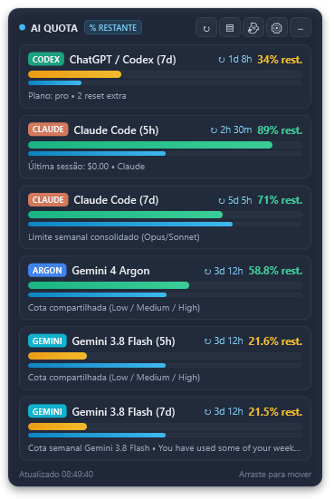
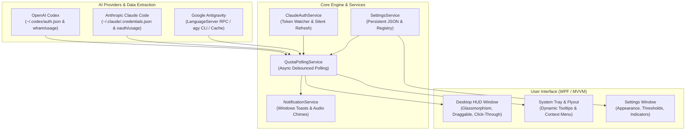

<div align="center">

# AI Usage Tracker

### Real-Time Desktop HUD & System Tray Quota Monitor for AI Coding Assistants

[](https://dotnet.microsoft.com/download/dotnet/10.0)
[](https://www.microsoft.com/windows)
[](https://github.com/LeGustaVinho/ai-usage-tracker/releases/latest)
[](LICENSE)
[](https://github.com/LeGustaVinho/ai-usage-tracker/actions/workflows/ci.yml)
[](CONTRIBUTING.md)

<br/>



<p><em>Real-time Dark Glass HUD displaying live quotas, reset countdowns, and utilization across OpenAI Codex, Anthropic Claude Code, and Google Antigravity.</em></p>

**[Download for Windows (x64)](https://github.com/LeGustaVinho/ai-usage-tracker/releases/latest)**

</div>

---

## Overview

Modern AI-assisted development tools like **OpenAI Codex / ChatGPT**, **Anthropic Claude Code**, and **Google Antigravity** employ session windows (e.g. 5-hour limits) and weekly quotas (7-day limits). Getting interrupted by an unexpected rate limit in the middle of a refactoring session or critical bug fix halts workflow and productivity.

**AI Usage Tracker** is a lightweight, high-performance **WPF (.NET 10)** desktop application for Windows that gives you unified, ambient visibility over all your AI quotas. It delivers a floating, customizable dark glass HUD on your screen and integrates cleanly into the Windows System Tray with native audio notifications on quota resets.

---

## ✨ Features

### 🎯 Multi-Provider Support Out of the Box
- **OpenAI Codex / ChatGPT**:
  - Live monitoring of 5-hour and 7-day windows when the `wham/usage` OAuth API reports them.
  - Automatically identifies current plan tier (`prolite`, `plus`, `pro`, etc.).
  - Precise reset countdown timers (`↻ 6d 14h`).
  - Fallback parsing of local session JSONL files if the network is unavailable.
- **Anthropic Claude Code**:
  - Real-time 5-hour session utilization (`claude.session`).
  - 7-day rolling quota tracking (`claude.weekly`).
  - Dedicated Opus (`claude.opus`) and Sonnet (`claude.sonnet`) rate-limit windows.
  - Dedicated **Claude Fable (7d)** quota (`claude.fable`) when the account reports a weekly Fable limit.
  - **Zero-Friction Token Healing**: Silent, automatic token refresh via Anthropic's OAuth endpoint; triggers non-blocking interactive login only when tokens are permanently revoked.
- **Google Antigravity**:
  - **Gemini (7d)** and **Gemini (5h)** display the shared quota (`gemini-weekly` and `gemini-5h`). The subtitle and tooltip list models whose membership is known, including Gemini 3.8 Flash and Gemini 4 Hydrogen when available.
  - **Gemini 4 Argon** and **Gemini 4 Carbon** appear under the shared quota or in dedicated cards according to the reported groups. On Google AI Pro, Argon has its own weekly quota. Each reported window has its own balance and reset.
  - Reads the local LanguageServer quota summary first, then `agy -p "/usage" --output-format json` when CLI fallback is enabled. The CLI catalog is refreshed through `agy models` at most once every five minutes per executable.
  - When group data is unavailable, the tracker uses the compatible cache if available, then shows the balance reported by the local model. The cycle progress bar requires a reported window.

Fable, Argon, and Carbon have independent visibility settings. For Antigravity models, **Indisponível nesta conta** means the catalog indicated unavailability, while **Cota não reportada** means the tracker could not establish a balance.

---

### 🪟 Sleek Desktop HUD (Glassmorphism Dark Widget)
- **Ambient & Non-Intrusive**: Styled with semi-transparent dark glass, rounded borders, and subtle glow accents.
- **Always on Top & Draggable**: Snap it anywhere on your desktop; position and size are automatically remembered across restarts.
- **Click-Through Mode**: Press the lock icon or enable click-through (`WS_EX_TRANSPARENT`) so mouse events pass right through to windows beneath.
- **Compact / Minimalist View**: Collapse headers and details down to clean, compact progress bars with a single click.
- **Display Mode Toggle** switches between **% Used** (default) and **% Remaining**.
- **Reset Progress** shows a countdown and a separate progress bar for quotas with a known reset time.
- **Collapsible 5-hour cards**: When matching 5-hour and 7-day quotas are both present, the session card sits inside the weekly card. Click **Cota de 5h** to collapse or expand it. The collapsed header shows two small, unlabeled bars for usage and reset progress when data is available. The HUD and tray flyout share the expanded state during the current app session. A 5-hour quota appears on its own when its matching weekly card is absent.

---

### 🔔 Native Audio & Toast Notifications
- **Sound on Reset / Recovery**: Receive a Windows native notification and system chime when a depleted quota resets or recovers, so you know immediately when you can code again.
- **Proactive Token Expiry Alerts**: Warns you with audio when an OAuth session needs attention.

---

### 📌 Windows 11 System Tray & Flyout
- **Dynamic Tray Icon**: Displays status tooltips and quick visual health indicators.
- **Modern Flyout**: Click the tray icon to pop up a Windows 11-styled flyout menu without opening full windows.
- **Comprehensive Context Menu**: Quick access to Refresh, Settings, HUD toggle, Click-Through toggle, and Exit.

---

### ⚙️ Rich Customization & Thresholds
- **Customizable Color Limits**: Set your own warning (e.g. 20%) and critical (e.g. 5%) thresholds with smooth color transitions (Green → Yellow/Orange → Red).
- **Indicator Reordering & Visibility**: Enable, disable, and rearrange quota cards to match your personal workflow.
- **Adjustable Polling Interval & Opacity** lets you tune background polling (10 to 3,600 seconds) and widget transparency.

---

### 🔒 100% Private, Local & Secure
- **Zero Telemetry**: No tracking data, usage metrics, or logs are sent to external analytics.
- **Local Credentials**: Reads existing local tokens from standard paths (`~/.codex/auth.json`, `~/.claude/.credentials.json`, Windows Keyring).
- **Direct HTTPS**: All API calls are made directly from your machine to official provider endpoints (OpenAI, Anthropic, Google Cloud Code).

---

## 🏗️ Architecture



---

## 🚀 Getting Started

### Run the portable release

1. Open the [latest release](https://github.com/LeGustaVinho/ai-usage-tracker/releases/latest) and download `AIUsageTracker-v<version>-win-x64.zip` from **Assets**.
2. Extract the ZIP to a folder you can write to and run `AIUsageTracker.exe`.
3. Use the AI Usage Tracker icon in the Windows notification area to open settings, refresh quotas, or exit.

The package targets Windows 10 (build 19041 or later) and Windows 11 on x64. It includes the .NET Desktop Runtime and runs directly from the extracted folder. Sign in to the provider tools you want to monitor with your existing accounts. The Antigravity fallback uses an authenticated `agy` CLI when available.

To update, exit from the tray and replace the files with the contents of the new ZIP. Keep the executable at the same path if you use **Start with Windows**. Settings are stored separately in `%APPDATA%\AIUsageTracker\settings.json`.

Each release includes a SHA-256 checksum. To verify a download, run `Get-FileHash -Algorithm SHA256 -LiteralPath <zip-path>` in PowerShell and compare the hash with the published checksum.

### Running from Source

Building from source requires the [.NET 10 SDK](https://dotnet.microsoft.com/download/dotnet/10.0) on Windows.
1. Clone this repository:
   ```bash
   git clone https://github.com/LeGustaVinho/ai-usage-tracker.git
   cd ai-usage-tracker
   ```
2. Build and run:
   ```bash
   dotnet run --project src/AIUsageTracker
   ```
   *(Or double-click `run-tracker.bat` in the repository root).*

### Building a Standalone Executable
To build the self-contained Windows x64 executable, run this command from the repository root:

```powershell
dotnet publish src/AIUsageTracker/AIUsageTracker.csproj -c Release -r win-x64 --self-contained true -p:PublishSingleFile=true -p:IncludeNativeLibrariesForSelfExtract=true -o ./dist/publish
```
The executable is written to `./dist/publish/AIUsageTracker.exe`.

---

## 🧪 Testing

The automated tests cover provider parsing, token expiry, Antigravity quota source selection and cache recovery, reset notifications, and collapsible quota grouping.

```bash
dotnet test
```

---

## ⚙️ Configuration & Settings

Configuration is automatically stored in:
```
%APPDATA%\AIUsageTracker\settings.json
```

### Key Settings

| Property | Default | Description |
| :--- | :--- | :--- |
| `RefreshIntervalSeconds` | `60` | Polling interval in seconds (minimum 10s). |
| `ShowDesktopWidget` | `true` | Toggles display of the floating Desktop HUD. |
| `WidgetOpacity` | `0.92` | Opacity of the HUD window (from 0.3 to 1.0). |
| `ClickThrough` | `false` | Passes mouse clicks through the HUD. |
| `CompactMode` | `false` | Displays compact quota cards. |
| `ShowRemainingInsteadOfUsed` | `false` | Shows quota remaining instead of quota used. |
| `ShowResetCountdown` | `true` | Shows the reset countdown and progress bar when a reset time is available. |
| `WarningThresholdPercent` | `60.0` | Percentage used at which the progress bar turns yellow. |
| `CriticalThresholdPercent` | `85.0` | Percentage used at which the progress bar turns red. |
| `EnableResetNotifications` | `true` | Enables Windows tray notifications when quotas reset. |
| `PlaySoundOnNotification` | `true` | Plays a system sound when a notification fires. |
| `ShowClaudeFable` | `true` | Shows the Claude Fable weekly quota card. |
| `ShowAntigravityArgon` | `true` | Shows Gemini 4 Argon in the shared model list or as a dedicated indicator. |
| `ShowAntigravityCarbon` | `true` | Shows Gemini 4 Carbon in the shared model list or as a dedicated indicator. |
| `ShowAntigravityFlash` | `true` | Shows the shared Gemini 5-hour quota. |
| `ShowAntigravityGeminiWeekly` | `true` | Shows the shared Gemini weekly quota. |
| `EnableAntigravityCliFallback` | `true` | Runs `agy -p "/usage"` when the local Gemini quota summary is unavailable. |

---

## 🛠️ Tech Stack

- **Framework**: [.NET 10.0](https://dotnet.microsoft.com/) / Windows Presentation Foundation (WPF)
- **Language**: C# with nullable reference types and file-scoped namespaces
- **Architecture**: MVVM with WPF data binding
- **Serialization**: `System.Text.Json`
- **Native Interop**: P/Invoke for Win32 API (`user32.dll`, `dwmapi.dll`) for window styles, transparency, and tray messaging
- **Testing**: `xUnit` and `Microsoft.NET.Test.Sdk`

---

## 🤝 Contributing

Contributions, issues, and feature requests are welcome!
Feel free to check the [issues page](https://github.com/LeGustaVinho/ai-usage-tracker/issues) or read our [Contributing Guidelines](CONTRIBUTING.md).

1. Fork the Project
2. Create your Feature Branch (`git checkout -b feat/AmazingFeature`)
3. Commit your Changes (`git commit -m 'feat: add some amazing feature'`)
4. Push to the Branch (`git push origin feat/AmazingFeature`)
5. Open a Pull Request

---

## 📜 License

Distributed under the **MIT License**. See [`LICENSE`](LICENSE) for more information.

---

## 🙏 Acknowledgments

- [OpenAI](https://openai.com/) for Codex / ChatGPT tools.
- [Anthropic](https://anthropic.com/) for Claude Code CLI and OAuth APIs.
- [Google Cloud Code](https://cloud.google.com/code) & Antigravity team for `agy` CLI and model services.
