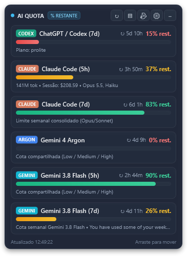
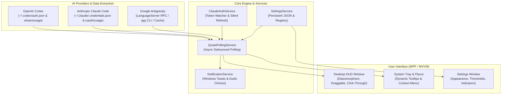

<div align="center">

# AI Usage Tracker

### Real-Time Desktop HUD & System Tray Quota Monitor for AI Coding Assistants

[](https://dotnet.microsoft.com/download/dotnet/10.0)
[](https://www.microsoft.com/windows)
[](https://learn.microsoft.com/en-us/dotnet/csharp/)
[](LICENSE)
[]()
[](CONTRIBUTING.md)

<br/>



<p><em>Real-time Dark Glass HUD displaying live quotas, reset countdowns, and utilization across OpenAI Codex, Anthropic Claude Code, and Google Antigravity.</em></p>

</div>

---

## Overview

Modern AI-assisted development tools like **OpenAI Codex / ChatGPT**, **Anthropic Claude Code**, and **Google Antigravity (Gemini & Argon)** employ rolling session windows (e.g. 5-hour limits) and weekly bucket quotas (7-day limits). Getting interrupted by an unexpected rate limit in the middle of a refactoring session or critical bug fix halts workflow and productivity.

**AI Usage Tracker** is a lightweight, high-performance **WPF (.NET 10)** desktop application for Windows that gives you unified, ambient visibility over all your AI quotas. It delivers a floating, customizable dark glass HUD on your screen and integrates cleanly into the Windows System Tray with native audio notifications on quota resets.

---

## ✨ Features

### 🎯 Multi-Provider Support Out of the Box
- **OpenAI Codex / ChatGPT**:
  - Live 7-day rolling window monitoring via `wham/usage` OAuth API.
  - Automatically identifies current plan tier (`prolite`, `plus`, `pro`, etc.).
  - Precise reset countdown timers (`↻ 6d 14h`).
  - Fallback parsing of local session JSONL files if the network is unavailable.
- **Anthropic Claude Code**:
  - Real-time 5-hour session utilization (`claude.session`).
  - 7-day rolling quota tracking (`claude.weekly`).
  - Dedicated Opus (`claude.opus`) and Sonnet (`claude.sonnet`) rate-limit windows.
  - **Zero-Friction Token Healing**: Silent, automatic token refresh via Anthropic's OAuth endpoint; triggers non-blocking interactive login only when tokens are permanently revoked.
- **Google Antigravity (Gemini & Argon)**:
  - Weekly quota tracking for **Gemini 3.8 Flash** (`gemini-weekly`).
  - 5-hour rolling session tracking (`gemini-5h`).
  - Dedicated tracking for **Gemini 4 Argon** (`gemini-argon-wtu-weekly`).
  - **Three-Tier Fallback Architecture**:
    1. *IDE LanguageServer RPC*: Ultra-fast (<10ms) local probe when Antigravity IDE is running.
    2. *CLI Fallback*: Seamlessly queries `agy -p "/quota" --output-format json` in the background if the IDE is closed.
    3. *Last Known Quota Cache*: Never flashes "OFFLINE 0%". If offline, preserves actual progress bars and countdowns with an informative `• Última cota conhecida` subtitle.

---

### 🪟 Sleek Desktop HUD (Glassmorphism Dark Widget)
- **Ambient & Non-Intrusive**: Styled with semi-transparent dark glass, rounded borders, and subtle glow accents.
- **Always on Top & Draggable**: Snap it anywhere on your desktop; position and size are automatically remembered across restarts.
- **Click-Through Mode**: Press the lock icon or enable click-through (`WS_EX_TRANSPARENT`) so mouse events pass right through to windows beneath.
- **Compact / Minimalist View**: Collapse headers and details down to clean, compact progress bars with a single click.
- **Display Mode Toggle**: Instant switch between **% Remaining** (default) and **% Used**.

---

### 🔔 Native Audio & Toast Notifications
- **Sound on Reset / Recovery**: Receive a Windows native notification and system chime when a depleted quota resets or recovers, so you know immediately when you can code again.
- **Proactive Token Expiry Alerts**: Warns you with audio when an OAuth session needs attention.

---

### 📌 Windows 11 System Tray & Flyout
- **Dynamic Tray Icon**: Displays status tooltips and quick visual health indicators.
- **Modern Flyout**: Click the tray icon to pop up a Windows 11-styled flyout menu without opening full windows.
- **Comprehensive Context Menu**: Quick access to Refresh, Settings, HUD toggle, Click-Through toggle, and Exit.

---

### ⚙️ Rich Customization & Thresholds
- **Customizable Color Limits**: Set your own warning (e.g. 20%) and critical (e.g. 5%) thresholds with smooth color transitions (Green → Yellow/Orange → Red).
- **Indicator Reordering & Visibility**: Enable, disable, and rearrange quota cards to match your personal workflow.
- **Adjustable Polling Interval & Opacity**: Tune background polling frequency (10s to 600s) and widget transparency to your preference.

---

### 🔒 100% Private, Local & Secure
- **Zero Telemetry**: No tracking data, usage metrics, or logs are sent to external analytics.
- **Local Credentials**: Reads existing local tokens from standard paths (`~/.codex/auth.json`, `~/.claude/.credentials.json`, Windows Keyring).
- **Direct HTTPS**: All API calls are made directly from your machine to official provider endpoints (OpenAI, Anthropic, Google Cloud Code).

---

## 🏗️ Architecture



---

## 🚀 Getting Started

### Prerequisites
- **Operating System**: Windows 10 (Build 19041+) or Windows 11 (64-bit)
- **Runtime**: [.NET 10.0 Desktop Runtime](https://dotnet.microsoft.com/download/dotnet/10.0) (or [.NET 10.0 SDK](https://dotnet.microsoft.com/download/dotnet/10.0) if building from source)

### Running from Source
1. Clone this repository:
   ```bash
   git clone https://github.com/LeGustaVinho/ai-usage-tracker.git
   cd ai-usage-tracker
   ```
2. Build and run:
   ```bash
   dotnet run --project src/AIUsageTracker
   ```
   *(Or double-click `run-tracker.bat` in the repository root).*

### Building a Standalone Executable
To create a single, self-contained executable that runs on any modern 64-bit Windows machine without requiring .NET pre-installed:

```bash
dotnet publish src/AIUsageTracker/AIUsageTracker.csproj \
  -c Release \
  -r win-x64 \
  --self-contained true \
  -p:PublishSingleFile=true \
  -p:IncludeNativeLibrariesForSelfExtract=true \
  -o ./dist
```
The resulting executable will be placed in `./dist/AIUsageTracker.exe`.

---

## 🧪 Testing

The repository contains an automated test suite verifying provider parsing, silent token refresh, quota bucket separation (e.g. Gemini vs. Argon), and fallback cache recovery:

```bash
dotnet test
```

All 28 unit tests run in <2 seconds:
```
Passed!  – Failed: 0, Passed: 28, Skipped: 0, Total: 28
```

---

## ⚙️ Configuration & Settings

Configuration is automatically stored in:
```
%APPDATA%\AIUsageTracker\settings.json
```

### Key Settings

| Property | Default | Description |
| :--- | :--- | :--- |
| `RefreshIntervalSeconds` | `60` | Polling interval in seconds (minimum 10s). |
| `ShowDesktopWidget` | `true` | Toggles display of the floating Desktop HUD. |
| `WidgetOpacity` | `0.92` | Opacity of the HUD window (from 0.3 to 1.0). |
| `IsClickThrough` | `false` | When true, passes mouse clicks through the HUD. |
| `IsCompactMode` | `false` | Displays minimalist progress bars without full card headers. |
| `DisplayMode` | `RemainingPercent` | `RemainingPercent` or `UsedPercent`. |
| `WarningThresholdPercent` | `25.0` | Threshold where progress bar turns yellow. |
| `CriticalThresholdPercent` | `10.0` | Threshold where progress bar turns red. |
| `EnableResetNotifications` | `true` | Enables Windows toast notifications when quotas reset. |
| `PlaySoundOnResetNotification` | `true` | Plays system audio chime when a notification fires. |
| `EnableAntigravityCliFallback` | `true` | Runs `agy -p "/quota"` via CLI when Antigravity IDE is closed. |

---

## 🛠️ Tech Stack

- **Framework**: [.NET 10.0](https://dotnet.microsoft.com/) / Windows Presentation Foundation (WPF)
- **Language**: C# 13 (Nullable reference types enabled, file-scoped namespaces)
- **Architecture**: MVVM pattern powered by `CommunityToolkit.Mvvm`
- **Serialization**: `System.Text.Json` with source-generated options
- **Native Interop**: P/Invoke for Win32 API (`user32.dll`, `dwmapi.dll`) for window styles, transparency, and tray messaging
- **Testing**: `xUnit` and `Microsoft.NET.Test.Sdk`

---

## 🤝 Contributing

Contributions, issues, and feature requests are welcome!
Feel free to check the [issues page](https://github.com/LeGustaVinho/ai-usage-tracker/issues) or read our [Contributing Guidelines](CONTRIBUTING.md).

1. Fork the Project
2. Create your Feature Branch (`git checkout -b feat/AmazingFeature`)
3. Commit your Changes (`git commit -m 'feat: add some amazing feature'`)
4. Push to the Branch (`git push origin feat/AmazingFeature`)
5. Open a Pull Request

---

## 📜 License

Distributed under the **MIT License**. See [`LICENSE`](LICENSE) for more information.

---

## 🙏 Acknowledgments

- [OpenAI](https://openai.com/) for Codex / ChatGPT tools.
- [Anthropic](https://anthropic.com/) for Claude Code CLI and OAuth APIs.
- [Google Cloud Code](https://cloud.google.com/code) & Antigravity team for `agy` CLI and model services.
